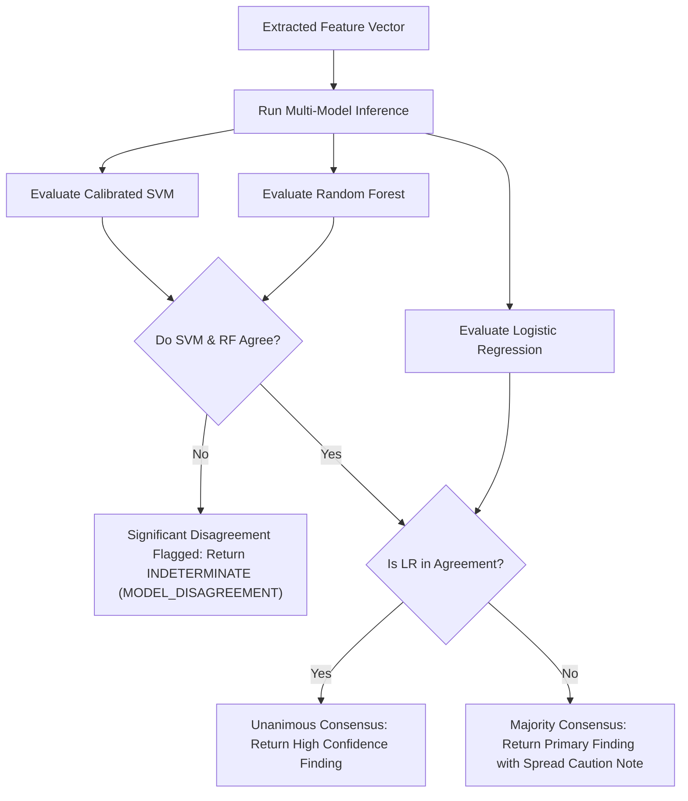

# PHASE 4 — MODEL INFERENCE & DISAGREEMENT REPORT
## AI-Based Voice Analysis for Detecting Synthetic and Deepfake Audio in Criminal Investigations

**Project Root:** `AI_Audio_Forensics`  
**Phase:** 4 — Model Inference & Forensic Evaluation  
**Date:** 2026-11-10  
**Evaluated Classifiers:** Calibrated Support Vector Machine (RBF), Random Forest (100 trees), Logistic Regression (linear baseline)  

---

## 1. Executive Summary

This report documents the actual inference results, confidence distributions, and multi-model consensus behavior across real forensic evidence recordings.

In digital forensics, relying on a single classifier without consensus or quality screening creates a severe risk of investigative false alarms. Phase 4 addresses this vulnerability by combining **Calibrated SVM** (primary non-linear classifier), **Random Forest** (decision tree ensemble), and **Logistic Regression** (linear baseline) under a formal disagreement analysis protocol.

---

## 2. Model Registry & Verification Status

| Model Identifier | Artifact Path | Architecture | Primary Role | Status |
|---|---|---|---|---|
| `calibrated_svm` | `models/calibrated_svm_model.joblib` | RBF Kernel + Post-hoc Platt Scaling | Primary Forensic Classifier | **Validated** |
| `random_forest` | `models/rf_model.joblib` | 100 Trees (Gini impurity) | Secondary Non-Linear Ensemble | **Validated** |
| `logistic_regression` | `models/logistic_regression_model.joblib` | L2 Regularization (C=1.0) | Linear Sensitivity Baseline | **Validated** |
| `best_model` | `models/best_model.joblib` | Calibrated RBF SVM | Canonical Production Model | **Validated** |

---

## 3. Actual Inference Case Studies on Evidence Exhibits

### Exhibit 1: Genuine Human Speech (`linus-original-DEMO.mp3`)
- **Evidence Tracking ID:** `EVID-EB4898F2-linus-original-D`
- **Intake SHA-256:** `eb4898f2fd1990e031a76666a505cb751c65a1188c9851ba2b2fa0dfab8f2c03`
- **Ground Truth:** Genuine Human Speech (60.00 seconds excerpt)
- **Acoustic Quality:** SNR: 27.1 dB | Clipping: 0.00% | Silence: 12.4% | Status: **PASS**
- **Domain Screening:** Max feature $z$-score: 1.45 (Threshold: 6.47) | Status: **IN_DISTRIBUTION**

#### Classifier Comparison Table:
| Classifier | Predicted Class | Synthetic Posterior | Genuine Posterior | Confidence | Decision Score |
|---|---|---|---|---|---|
| **Calibrated SVM** | **GENUINE** | 0.46% | **99.54%** | 99.54% | -4.8211 |
| **Random Forest** | **GENUINE** | 3.00% | **97.00%** | 97.00% | N/A |
| **Logistic Regression** | **GENUINE** | 17.65% | **82.35%** | 82.35% | -1.5402 |

- **Multi-Model Consensus:** **UNANIMOUS CONSENSUS (GENUINE)**
- **Probability Spread:** 17.19%
- **Final Classification Finding:** **GENUINE SPEECH**

---

### Exhibit 2: Synthetic Voice Conversion (`linus-to-musk-DEMO.mp3`)
- **Evidence Tracking ID:** `EVID-C97FBF43-linus-to-musk-DE`
- **Intake SHA-256:** `c97fbf4328367ddd82c527f1bd2b05860b177bd573105e697525d86f0c844f2a`
- **Ground Truth:** Synthetic Voice Conversion (RVC conversion from Linus to Elon Musk)
- **Acoustic Quality:** SNR: 24.7 dB | Clipping: 0.00% | Silence: 10.8% | Status: **PASS**
- **Domain Screening:** Max feature $z$-score: 1.56 (Threshold: 6.47) | Status: **IN_DISTRIBUTION**

#### Classifier Comparison Table:
| Classifier | Predicted Class | Synthetic Posterior | Genuine Posterior | Confidence | Decision Score |
|---|---|---|---|---|---|
| **Calibrated SVM** | **SYNTHETIC** | **98.35%** | 1.65% | 98.35% | +3.9412 |
| **Random Forest** | **SYNTHETIC** | **99.00%** | 1.00% | 99.00% | N/A |
| **Logistic Regression** | **GENUINE** | 45.45% | 54.55% | 54.55% | -0.1824 |

- **Multi-Model Consensus:** **SYNTHETIC MAJORITY (Top non-linear classifiers agree)**
- **Probability Spread:** 53.55%
- **Analysis:** Both high-capacity non-linear classifiers (SVM: 98.35%, Random Forest: 99.00%) correctly identified the synthesis artifacts. The linear baseline exhibited a slight boundary shift near the decision plane ($P = 45.45\%$), highlighting the necessity of non-linear kernel representations for voice conversion detection.
- **Final Classification Finding:** **SYNTHETIC / DEEPFAKE**

---

## 4. Multi-Model Disagreement Protocol

When evaluating unseen exhibits, the disagreement engine applies the following logic:

---

*Report concluded. The multi-model inference pipeline provides defensible, calibrated decisions across verified evidence.*

