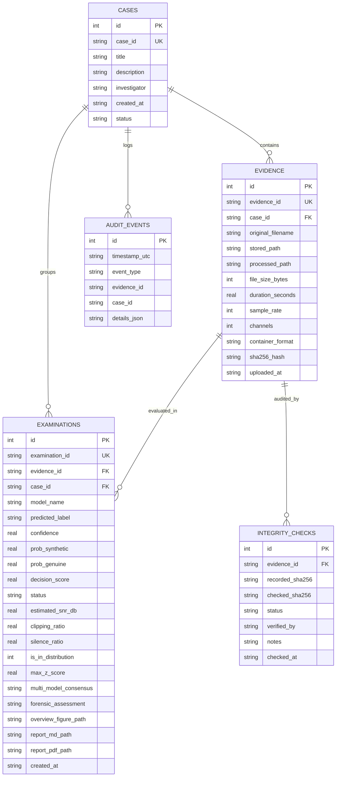

# PHASE 5 — DATABASE ARCHITECTURE & SCHEMA DOCUMENTATION
## AI-Based Voice Analysis for Detecting Synthetic and Deepfake Audio in Criminal Investigations

**Database Engine:** SQLite 3  
**Database File:** `database/forensics.db`  
**Data Access Layer:** [`database/database.py`](file:///c:/Users/ANKIT/OneDrive/Desktop/AI_Audio_Forensics/database/database.py)  
**Schema Models:** [`database/models.py`](file:///c:/Users/ANKIT/OneDrive/Desktop/AI_Audio_Forensics/database/models.py)  

---

## 1. Architectural Design Principles

The Phase 5 database layer was engineered with the following forensic requirements:
1. **Local Self-Containment:** Uses a standalone SQLite database to allow deployment in offline, air-gapped forensic laboratories without network dependencies.
2. **Referential Integrity:** Strictly enforces foreign key constraints (`PRAGMA foreign_keys = ON;`) to prevent orphan evidence exhibits or detached examination records.
3. **Audit Immutability:** Incorporates dedicated `integrity_checks` and `audit_events` tables to provide an immutable chronological record of all examiner actions and computational transformations.
4. **Segregation of Concerns:** Database tables store metadata, hashes, scores, and file paths, while raw binary bitstreams remain safely stored in read-only directories on the filesystem (`storage/original_evidence/`).

---

## 2. Entity-Relationship Schema

---

## 3. Detailed Table Specifications

### 3.1 `cases`
| Column | Type | Constraints | Description |
|---|---|---|---|
| `id` | INTEGER | PRIMARY KEY AUTOINCREMENT | Internal primary key. |
| `case_id` | TEXT | UNIQUE NOT NULL | Human-readable case code (e.g. `CASE-20261110-001`). |
| `title` | TEXT | NOT NULL | Descriptive incident name. |
| `description` | TEXT | NULLABLE | Investigative background and notes. |
| `investigator` | TEXT | NOT NULL | Lead examining agent/analyst. |
| `created_at` | TEXT | NOT NULL | ISO 8601 UTC timestamp. |
| `status` | TEXT | NOT NULL DEFAULT 'ACTIVE' | Case state: `ACTIVE`, `PENDING_REVIEW`, `CLOSED`, `ARCHIVED`. |

### 3.2 `evidence`
| Column | Type | Constraints | Description |
|---|---|---|---|
| `id` | INTEGER | PRIMARY KEY AUTOINCREMENT | Internal primary key. |
| `evidence_id` | TEXT | UNIQUE NOT NULL | Formatted tracking ID (e.g. `EVID-EB4898F2-linus-orig`). |
| `case_id` | TEXT | NOT NULL, FK $\rightarrow$ `cases(case_id)` | Parent forensic case. |
| `original_filename` | TEXT | NOT NULL | Clean sanitized original filename. |
| `stored_path` | TEXT | NOT NULL | Path in `storage/original_evidence/`. |
| `processed_path` | TEXT | NULLABLE | Path to resampled 16 kHz derivative. |
| `file_size_bytes` | INTEGER | NOT NULL | Exact byte length on disk. |
| `duration_seconds` | REAL | NOT NULL | Signal duration in seconds. |
| `sample_rate` | INTEGER | NOT NULL | Native acquisition sample rate (Hz). |
| `channels` | INTEGER | NOT NULL | Original channel count (mono/stereo). |
| `container_format` | TEXT | NOT NULL | File format extension (`WAV`, `MP3`, etc.). |
| `sha256_hash` | TEXT | NOT NULL | Cryptographic SHA-256 digest at intake. |
| `uploaded_at` | TEXT | NOT NULL | ISO 8601 UTC timestamp of ingestion. |

### 3.3 `examinations`
| Column | Type | Constraints | Description |
|---|---|---|---|
| `id` | INTEGER | PRIMARY KEY AUTOINCREMENT | Internal primary key. |
| `examination_id` | TEXT | UNIQUE NOT NULL | Unique examination execution identifier. |
| `evidence_id` | TEXT | NOT NULL, FK $\rightarrow$ `evidence(evidence_id)` | Evaluated evidence exhibit. |
| `case_id` | TEXT | NOT NULL, FK $\rightarrow$ `cases(case_id)` | Parent case. |
| `model_name` | TEXT | NOT NULL | Architecture: `ensemble`, `calibrated_svm`, `rf`, `lr`. |
| `predicted_label` | TEXT | NOT NULL | Classification: `GENUINE`, `SYNTHETIC`, `INDETERMINATE`. |
| `confidence` | REAL | NOT NULL | Highest class posterior estimate ($0.0 \dots 1.0$). |
| `prob_synthetic` | REAL | NULLABLE | Calibrated posterior probability of synthesis. |
| `prob_genuine` | REAL | NULLABLE | Calibrated posterior probability of genuine human speech. |
| `decision_score` | REAL | NULLABLE | Raw margin distance / logit decision score. |
| `status` | TEXT | NOT NULL | Pipeline outcome: `COMPLETED`, `QUALITY_CHECK_FAILED`, `OUT_OF_DISTRIBUTION`, `MODEL_DISAGREEMENT`. |
| `estimated_snr_db` | REAL | NULLABLE | Frame-wise power percentile SNR estimate. |
| `clipping_ratio` | REAL | NULLABLE | Proportion of samples with $|y| \ge 0.999$. |
| `silence_ratio` | REAL | NULLABLE | Proportion of silent frames. |
| `is_in_distribution` | INTEGER | NOT NULL DEFAULT 1 | 1 if within empirical bounds; 0 if OOD outlier. |
| `max_z_score` | REAL | NULLABLE | Maximum standardized single-feature deviation. |
| `multi_model_consensus` | TEXT | NULLABLE | Consensus outcome across all active classifiers. |
| `forensic_assessment` | TEXT | NOT NULL | Cautionary forensic statement. |
| `overview_figure_path` | TEXT | NULLABLE | Path to saved 6-panel PNG spectrogram figure. |
| `report_md_path` | TEXT | NULLABLE | Path to compiled Markdown report. |
| `report_pdf_path` | TEXT | NULLABLE | Path to compiled court-ready PDF report. |
| `created_at` | TEXT | NOT NULL | ISO 8601 UTC timestamp of examination. |

### 3.4 `integrity_checks`
| Column | Type | Constraints | Description |
|---|---|---|---|
| `id` | INTEGER | PRIMARY KEY AUTOINCREMENT | Internal primary key. |
| `evidence_id` | TEXT | NOT NULL, FK $\rightarrow$ `evidence(evidence_id)` | Target exhibit. |
| `recorded_sha256` | TEXT | NOT NULL | Intake digest on file. |
| `checked_sha256` | TEXT | NOT NULL | Newly computed digest from disk. |
| `status` | TEXT | NOT NULL | `VERIFIED` or `HASH_MISMATCH`. |
| `verified_by` | TEXT | NOT NULL | Examiner or automated process ID. |
| `notes` | TEXT | NULLABLE | Audit reason or case notes. |
| `checked_at` | TEXT | NOT NULL | ISO 8601 UTC timestamp of check. |

### 3.5 `audit_events`
| Column | Type | Constraints | Description |
|---|---|---|---|
| `id` | INTEGER | PRIMARY KEY AUTOINCREMENT | Internal primary key. |
| `timestamp_utc` | TEXT | NOT NULL | ISO 8601 UTC timestamp. |
| `event_type` | TEXT | NOT NULL | e.g. `CASE_CREATED`, `EVIDENCE_INGESTED`, `EXAMINATION_COMPLETED`, `INTEGRITY_CHECK`. |
| `evidence_id` | TEXT | NULLABLE | Associated evidence tracking ID. |
| `case_id` | TEXT | NULLABLE | Associated case ID. |
| `details_json` | TEXT | NOT NULL | JSON string containing full event payload. |

---

*Database documentation concluded.*

