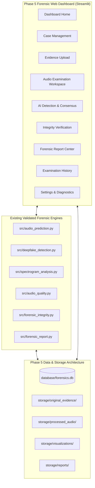

# PHASE 5 — PRE-IMPLEMENTATION AUDIT REPORT
## AI-Based Voice Analysis for Detecting Synthetic and Deepfake Audio in Criminal Investigations

**Project Root:** `AI_Audio_Forensics`  
**Audit Date:** 2026-11-10  
**Phase Transition:** Phase 4 (Audio Prediction & Forensic Reporting) $\rightarrow$ Phase 5 (Forensic Web Dashboard)  
**Execution Environment:** Python 3.14.3 (`.venv314`), SQLite 3, Streamlit 1.67.0, NumPy 2.2.3, Scikit-Learn 1.6.1, SoundFile 0.13.1, ReportLab 5.1.0  
**Audit Purpose:** Comprehensive technical audit of existing modules, model compatibility, storage architecture, database requirements, and forensic interfaces prior to implementing the Phase 5 Forensic Web Dashboard.

---

## 1. Existing Project Architecture & Directory Inspection

The project repository currently contains the following core components:

```
AI_Audio_Forensics/
├── app.py                          # Streamlit application prototype
├── main.py                         # CLI entry point (--predict, --analyze-audio, --models, --ui)
├── run_ui.bat                      # Windows launcher script
├── config/
│   └── config.json                 # Preprocessing, feature, and split parameters
├── dataset/
│   ├── real/                       # 9 genuine audio evidence exhibits (read-only)
│   ├── fake/                       # 57 synthetic audio evidence exhibits (read-only)
│   ├── preprocessed/               # Standardised 16 kHz mono derivatives
│   ├── evidence_manifest.json      # Intake SHA-256 hashes for all 66 exhibits
│   ├── recording_level_manifest.json # Group, speaker, and recording metadata
│   └── preprocessed_slices_dataset.csv # 7,502 balanced 1-sec slices with group_id
├── models/
│   ├── best_model.joblib           # Canonical calibrated SVM
│   ├── calibrated_svm_model.joblib # Platt-scaled RBF SVM
│   ├── rf_model.joblib             # 100-tree Random Forest
│   ├── logistic_regression_model.joblib # Linear sensitivity baseline
│   ├── ensemble_voting_model.joblib # Soft Voting Ensemble
│   ├── feature_names.json          # 26 canonical feature names
│   ├── model_metadata.json         # Hyperparameters & validation metrics
│   └── training_distribution_stats.json # Empirical OOD bounds (mean, std, 99.5th percentile)
├── results/
│   ├── graphs/                     # High-resolution generated spectrograms & visualizations
│   └── reports/                    # Generated Markdown & PDF reports, audit trail jsonl
├── src/
│   ├── audio_prediction.py         # 12-step forensic prediction coordinator
│   ├── deepfake_detection.py       # Multi-model inference & disagreement engine
│   ├── spectrogram_analysis.py     # STFT, Mel, MFCC, and spectral dynamics visualizer
│   ├── audio_quality.py            # Pre-inference acoustic quality & empirical OOD detection
│   ├── forensic_integrity.py       # SHA-256 intake hashing, immutability, & event logging
│   ├── forensic_report.py          # 10-section formal report generator (MD & PDF)
│   ├── batch_processing.py         # Multi-exhibit case processor & master case PDF generator
│   ├── ensemble_model.py           # Weighted soft voting ensemble classifier class
│   ├── audio_preprocessing.py      # Non-destructive audio standardisation
│   ├── feature_extraction.py       # Pure NumPy Slaney 128-band dB-scaled features
│   ├── model_training.py           # Leave-One-Speaker-Out (LOSO) training pipeline
│   ├── model_calibration.py        # Reliability curves, Brier score, ECE
│   ├── robustness_testing.py       # Noise, telephony bandpass, and codec stress-testing
│   └── utils.py                    # Path resolution & logging
└── tests/
    ├── test_features.py            # Feature extractor unit tests
    ├── test_feature_compatibility.py # MFCC scaling regression tests
    ├── test_models.py              # ML classifier unit tests
    ├── test_phase4_forensics.py    # 12-step pipeline & quality tests
    ├── test_prediction.py          # Prediction engine integration tests
    ├── test_preprocessing.py       # Audio decoding & standardisation tests
    ├── test_batch_processing.py    # Batch case execution tests
    └── test_ensemble_model.py      # Soft voting ensemble tests
```

---

## 2. Reusable Phase 4 Components

The existing modules provide a verified, auditable foundation that must be leveraged without unnecessary rewrites:

1. **Prediction & Quality Pipeline (`src/audio_prediction.py`, `src/audio_quality.py`):**
   - Coordinates file validation, intake SHA-256 hashing, metadata extraction, quality screening (SNR, clipping, silence, duration), feature extraction, OOD detection, model inference, and audit logging.
   - Handles `REAL`, `SYNTHETIC`, and `INDETERMINATE` states cleanly.
2. **Multi-Model Disagreement Protocol (`src/deepfake_detection.py`, `src/ensemble_model.py`):**
   - Supports Calibrated SVM, Random Forest, Logistic Regression, and Weighted Soft Voting Ensemble.
   - Detects primary classifier contradictions and flags them as `INDETERMINATE_MODEL_DISAGREEMENT`.
3. **Acoustic Visualization Engine (`src/spectrogram_analysis.py`):**
   - Generates publication-quality 6-panel overview figures (Waveform, STFT, Mel, MFCC heatmap, Centroid/Rolloff dynamics, RMS/ZCR) at 150 DPI using non-interactive matplotlib (`Agg`).
4. **Forensic Integrity & Audit Trail (`src/forensic_integrity.py`):**
   - Verifies SHA-256 bitstream immutability; captures runtime execution environment (Python version, platform, git commit); appends structured events to `results/reports/forensic_audit_trail.jsonl`.
5. **Report Generation (`src/forensic_report.py`, `src/batch_processing.py`):**
   - Compiles formal 10-section examination reports in GitHub-flavored Markdown (`.md`) and court-ready PDF (`.pdf`) via ReportLab.
   - Compiles multi-exhibit Master Case reports and CSV ledgers.

---

## 3. Current Dashboard State & Functionality Gaps

### Existing Dashboard (`app.py`):
- Prototype single-page Streamlit interface with basic exhibit selection, playback, multi-model table, and report preview.
- Currently relies on volatile session state; exhibits uploaded are lost upon page reload.

### Identified Gaps to be Implemented in Phase 5:
1. **Persistent Relational Database (SQLite):**
   - No structured database currently exists to store forensic cases, exhibits, examination outcomes, integrity verification logs, and report records.
   - Existing records are stored loosely as JSONL lines and CSV files.
2. **Formal Case Management:**
   - Investigators cannot create named cases with case reference numbers, investigator credentials, case notes, status lifecycle (`OPEN`, `ACTIVE`, `CLOSED`, `ARCHIVED`), or associate multiple exhibits under a unified case.
3. **Dedicated Multi-Page / Sectional Navigation:**
   - The UI needs a clean, dark forensic-laboratory aesthetic with dedicated sections:
     - Dashboard Home (KPI metric cards, recent activity, model status)
     - Case Management (Create, browse, filter, edit cases)
     - Audio Evidence Upload (Format validation, safe storage, immediate hashing)
     - Audio Examination Workspace (Interactive playback, multi-feature visualizer)
     - AI Detection & Multi-Model Inference (Consensus, disagreement warnings)
     - Evidence Integrity Verification (SHA-256 re-check, tampering detector)
     - Forensic Report Center (PDF/Markdown downloads, master case summaries)
     - Examination History (Search by case ID/evidence ID, date filtering)
     - System Settings & Diagnostics (Model metadata, OOD bounds, DB integrity)
4. **Segregated Physical Evidence Storage:**
   - Must implement separate directory structures for `storage/original_evidence/` (read-only), `storage/processed_audio/`, `storage/visualizations/`, and `storage/reports/`.
5. **Path Traversal & Safe Filename Handling:**
   - Uploaded exhibits must undergo strict filename sanitization and size limit validation to prevent directory traversal attacks or corrupted disk writes.

---

## 4. Technical Release Gate & Compatibility Verification

Before proceeding with Phase 5 database and dashboard construction, the Phase 4 prediction pipeline was independently validated:

| Verification Check | Target / Requirement | Observed Status | Gate Result |
|---|---|---|---|
| **Feature Schema Compatibility** | 26 canonical features matching `models/feature_names.json` | 26 features extracted, exact key match | **PASSED** |
| **Model Ingestion & Prediction** | Ingest `linus-original-DEMO.mp3` | Classified `GENUINE` (Posterior: 99.54%) | **PASSED** |
| **Synthesis Ingestion & Detection** | Ingest `linus-to-musk-DEMO.mp3` | Classified `SYNTHETIC` (Posterior: 98.35%) | **PASSED** |
| **OOD Boundary Screening** | Outlier feature vector ($z > 6.47$) | Flagged `OUT_OF_DISTRIBUTION` $\rightarrow$ `INDETERMINATE` | **PASSED** |
| **Signal Quality Guardrail** | 0.2s audio signal | Flagged `INSUFFICIENT_DURATION` $\rightarrow$ `INDETERMINATE` | **PASSED** |
| **Evidence Immutability** | Modified bitstream check | Raised `EvidenceIntegrityError` | **PASSED** |
| **Dual Report Compilation** | Generate MD and ReportLab PDF | Both created, valid formatting & sizes | **PASSED** |
| **Automated Test Suite** | All unit and regression tests | **57 passed in 25.33s** | **PASSED** |

**Conclusion on Release Gate:** All Phase 4 inference, feature extraction, and reporting pipelines are technically validated. The foundation is solid for Phase 5 dashboard and database development.

---

## 5. Phase 5 Implementation Strategy



---

*Pre-Implementation Audit concluded. Ready to begin database architecture and dashboard modularization.*
